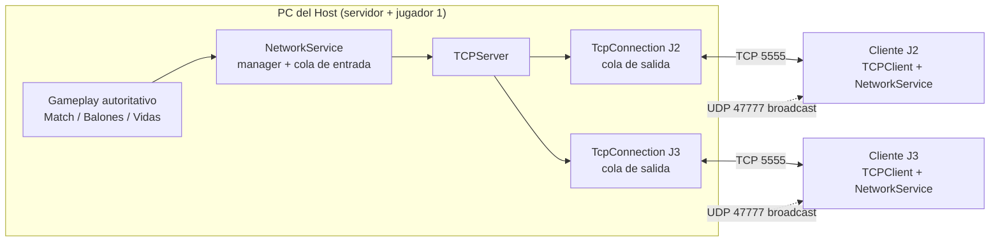
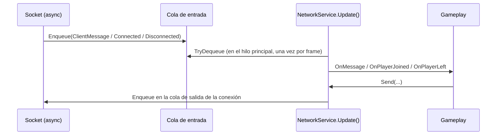
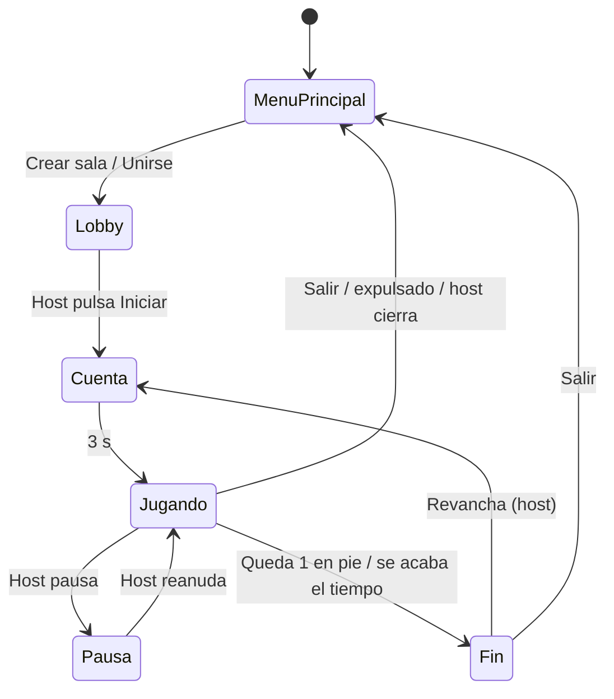

# Dodgeball FPS multijugador (Player-Host sobre TCP)

## Descripción general

Dodgeball en primera persona para 2 a 6 jugadores en red local. Un jugador crea una sala y hace de **host**: es servidor y a la vez juega como cualquier otro. Los demás jugadores se conectan a él como **clientes**. No hay servidor dedicado.

**Objetivo del juego:** golpear a los rivales con los balones para quitarles vidas. Gana el último jugador en pie. Si se acaba el tiempo, gana el superviviente con más puntos; si hay empate, no hay ganador.

| Acción | Puntos (por defecto, el host puede cambiarlos) |
|---|---|
| Golpear a un rival | +1 |
| Atrapar un balón en el aire (lanzado por otro) | +1 |
| Eliminar a un rival (quitarle la última vida) | +2 extra |

Cada jugador tiene un **color propio** (rojo, azul, verde, amarillo, morado o naranja) que tiñe su cuerpo. También lleva encima de la cabeza una **etiqueta con su nombre** del mismo color. Ese color se repite en el lobby y en el marcador.

---

## Requisitos técnicos

- **Unity 6000.3.16f1** (Unity 6.3) con URP.
- Paquetes que ya trae el proyecto: Input System 1.19, uGUI/TextMesh Pro, Universal RP 17.3.
- Windows 10/11 (probado en Windows). Sirve cualquier plataforma de escritorio con sockets .NET.
- Todos los equipos en la **misma red local** (Wi-Fi o LAN) para descubrir las salas por nombre. Por IP también se puede conectar a través de cualquier red que tenga alcance al host.
- Puertos usados:
  - **TCP 5555**: partida (host ⇄ clientes).
  - **UDP 47777**: descubrimiento de salas en la LAN (broadcast).
- En el PC del host, el **Firewall de Windows** debe permitir el juego o el editor de Unity (redes privadas). La primera vez Windows lo pregunta.

---

## Cómo ejecutar

### Desde el editor
1. Abrir el proyecto con Unity 6000.3.16f1.
2. Abrir la escena `Assets/_Project/Minigames/Dodgeball/Scenes/Bootstrap.unity`. En realidad cualquier escena funciona, porque el `NetworkService` se crea solo antes de cargar la primera.
3. Pulsar Play.

### Interfaz gráfica (una sola vez)
Las imágenes de `Assets/_Project/UI-UX/Images-Buttons` se montan en las escenas con el menú del editor **Dodgeball > Aplicar diseño de UI a las escenas**. La herramienta (`Assets/_Project/Editor/UIBuilder/`) modifica y guarda `MainMenu`, `Lobby` y `Dodgeball_Arena`:
- **Menú principal**: fondo, botones JUGAR, JUGAR LOCAL, CONFIGURACIÓN y SALIR.
- **Panel de salas**: nombre de la sala, CREAR SALA, UNIRSE A LA SALA y VOLVER AL MENÚ.
- **Configuración**: sensibilidad del ratón, volumen y pantalla completa. Se guarda en `PlayerPrefs`.
- **Lobby**: JUGAR para iniciar (host) y SALIR.
- **Pausa (Esc)**: CONTINUAR, CONFIGURACIÓN, VOLVER AL MENÚ y SALIR DEL JUEGO, más PAUSAR y REVANCHA para el host.
- **Resultados**: REVANCHA y VOLVER AL MENÚ.
- **Panel del host (F1)**: EXPULSAR, BANNEAR, PAUSAR, REVANCHA, APLICAR REGLAS y VALORES POR DEFECTO. Las imágenes se guardan en `Assets/_Project/UI-UX/Resources/UISkin.asset`.
- **Paneles de texto** (lobby, lista de salas, mensajes de estado, configuración, resultados, panel del host, objetivo y marcador): usan `panel-BG.png` en modo 9-slice, que se estira a lo ancho sin deformar las esquinas ni el borde rojo.
- **Tipografía**: todos los textos usan **Bangers** (`Assets/_Project/UI-UX/Fonts/Bangers-Regular.ttf`, licencia SIL OFL 1.1 en `OFL.txt`). La herramienta crea el font asset `Bangers SDF.asset`, lo deja como fuente por defecto de TextMesh Pro y lo aplica a escenas y prefabs. El panel del host y el marcador también la usan.
- **HUD en partida**: cajas `vidas-UI` (corazón), `tiempo-UI` (reloj) y `puntos-UI` (estrella) arriba de la pantalla de cada jugador, con su valor dentro. La caja de vidas se sacude al perder una vida y el tiempo se pone rojo en los últimos 10 s. Se montan en el prefab `Player`.
- **Deslizadores**: el balón (`Balon-slider.png`) es el tirador de los deslizadores de reglas del panel del host y de los de Configuración.
- **Sonidos** (`Assets/_Project/UI-UX/Sounds`). Todos siguen el volumen de Configuración.
  - `clic_boton`: todos los botones, incluidos los del panel del host.
  - `menos_una_vida`: cuando tu jugador pierde una vida.
  - `lanzamiento` y `impacto_personaje`: sonidos 3D en la posición del balón y del jugador golpeado. Los oyen el host y los clientes.
  - `victoria_estadio` / `derrota`: en la pantalla de resultados, según si ganaste.
  - `lobby_menu_loop`: música en bucle en el menú principal y el lobby, que se detiene en la arena.
- **Más botones**: REINICIAR, TERMINAR AHORA y CERRAR PANEL en el panel del host; PANEL HOST (F1) y REINICIAR en la pausa; CERRAR en Configuración; caja PELOTA en el HUD; paneles ¡VICTORIA! y ¡DERROTA! en resultados.
- **Últimos cambios de UI**: imagen REGLAS en el lobby, con una línea debajo que muestra los valores elegidos por el host; botón PANTALLA COMPLETA con SÍ/NO en Configuración; barra de carga del lanzamiento con `ChargeBar-Slider`; en la caja PELOTA aparece la imagen del balón cuando tienes uno en la mano.

Se puede volver a ejecutar sin que se dupliquen objetos: reconstruye todo lo que se llama `UI_...`. Si no se ejecuta, el juego funciona igual con la UI anterior y un menú de pausa básico.

### Compilado (recomendado para probar varios jugadores)
1. `File > Build Profiles`. Las escenas `Bootstrap`, `MainMenu`, `Lobby` y `Dodgeball_Arena` ya están en la lista y `Bootstrap` es la primera.
2. Compilar para Windows y copiar la carpeta a cada PC. También se pueden abrir varias instancias en el mismo PC.

### Host
1. En el menú principal, escribir un **nombre de sala** y pulsar **Crear sala**.
2. En el lobby se ven los jugadores conectados con su ping. Pulsar **F1** para abrir el panel de administración.
3. Pulsar **Iniciar partida** cuando estén todos. Se puede empezar con 1 jugador y los demás pueden entrar después.

### Clientes
1. En el menú principal, escribir el **nombre de la sala** (o la **IP del host**) y pulsar **Unirse**.
2. Se entra al lobby. Si la partida ya empezó, el cliente entra directamente a la arena.

### Jugar entre varios PCs: Firewall de Windows (importante)
Windows bloquea las conexiones entrantes del juego si al abrirlo por primera vez se cerró o canceló el aviso del firewall, o si la red está marcada como **Pública**. Síntomas típicos:
- **Ves la sala pero al unirte sale "no aceptó la conexión"**: el firewall del **PC del host** bloquea el TCP 5555.
- **No ves la sala que creó otro PC**: el firewall de **tu PC** bloquea el aviso de salas por UDP 47777.

Solución: copiar `Firewall-Dodgeball.bat` (en la raíz del repositorio) a la carpeta del build, junto a `MiniGames.exe`, y ejecutarlo con doble clic en **cada PC** (pide permisos de administrador). El script:
- quita las reglas que bloquean `MiniGames.exe`;
- permite los puertos TCP 5555 y UDP 47777 en todos los perfiles de red;
- permite el ejecutable.

Como alternativa, el host ve su IP en el lobby (`Tu IP: 192.168.x.x`) y los clientes pueden escribirla en lugar del nombre de la sala. Aun así, el firewall del host debe permitir el TCP 5555.

### Prueba en un solo PC
Abrir 2 o 3 instancias del build (o el editor más builds). Una crea la sala y las demás se unen con el nombre de la sala o con `127.0.0.1`.
> Ojo: en un mismo PC todos los clientes tienen la IP `127.0.0.1`. Si se banea esa IP, quedan baneados todos los clientes de ese PC. Se puede quitar el baneo desde el panel F1.

### Controles
| Tecla | Acción |
|---|---|
| W A S D | Moverse |
| Ratón | Mirar / apuntar |
| Espacio | Saltar |
| Shift izq. | Correr |
| Ctrl izq. | Agacharse |
| E | Recoger balón (o atraparlo en el aire) |
| F (mantener) | Cargar el lanzamiento; al soltar, se lanza |
| Tab (mantener) | Marcador: vidas, puntos y ping de cada jugador |
| Esc | Menú: continuar, salir; el host además puede pausar y reiniciar |
| P | Pausar / reanudar (solo el host) |
| F1 | Panel de administración (solo el host) |

---

## Funcionalidades implementadas

### Arquitectura Player-Host sobre TCP
- El host abre un `TcpListener` en el puerto 5555 y además tiene su propio jugador en la partida.
- El host es **autoritativo**. Simula la física, los balones, los golpes, las vidas, los puntos y el tiempo. Los clientes solo envían **intenciones** (su input). Si un cliente intenta enviar cualquier otro tipo de mensaje, el host lo descarta (`AllowedFromClients`). Además, el `senderId` lo pone siempre el host, nunca el cliente.
- Los mensajes son JSON (`JsonUtility`) con **framing por longitud**: cada mensaje va como `[4 bytes de longitud big-endian][cuerpo UTF-8]`. TCP es un flujo de bytes y no respeta los límites entre mensajes, así que el receptor usa esa longitud para reconstruir cada mensaje completo (`MessageFraming`, `FrameReader`).
- El UDP se usa **solo** para anunciar las salas en la LAN (`LanRoomDiscovery`). Toda la partida va por TCP.



### Gestión de red: colas y managers
- **`NetworkService`** (manager): la única puerta entre el gameplay y la red. Gestiona los jugadores, el lobby, el ping, los timeouts, los kicks y los bans.
- **Cola de entrada (`ConcurrentQueue<NetworkEvent>`)**: los sockets no llaman directamente al gameplay. Cada conexión, mensaje o desconexión se encola, y `NetworkService.Update()` la procesa en un punto fijo del frame. Así una entrada o salida de jugador nunca interrumpe código de juego a la mitad.
- **Cola de salida por conexión (`TcpConnection`)**: el gameplay solo encola. Un único *send loop* por conexión escribe los mensajes en orden. Un jugador lento no bloquea a los demás, y si acumula más de 2048 mensajes pendientes (alrededor de un minuto de snapshots) se le desconecta para proteger al host.
- **Hilos de red**: la lectura y escritura de cada socket corren en hilos de fondo (`ConfigureAwait(false)`), nunca en el hilo principal de Unity, y los mensajes pendientes se envían agrupados en una sola escritura. Los mensajes recibidos pasan al hilo principal solo a través de la cola concurrente de `NetworkService`. *Por qué*: una versión anterior hacía los `await` en el hilo principal, que solo retoma una continuación por frame. Eso limitaba cada conexión a **un mensaje por frame**: en la partida (unos 32 mensajes/s por cliente) la cola crecía y el ping del cliente subía a cientos de ms. Con los hilos de fondo el ping en LAN baja a unos pocos ms.
- **Generaciones de sesión**: los eventos que llegan tarde de una sesión anterior (por ejemplo, tras salir y volver a crear una sala) se descartan.
- Cada evento se procesa dentro de `try/catch`. Un mensaje corrupto o un error en un handler se registra en el log, pero no tumba al host.



### Conexión y desconexión durante la partida
- Si un jugador **entra a mitad de partida**, el host lo crea en la arena con las reglas actuales. El lobby del cliente ve `matchInProgress = true` y lo lleva directamente a la arena.
- Si un jugador **sale** (botón Salir, cierre del juego o caída de red), el host lo quita de la arena sin reiniciar la partida. Si solo queda un jugador en pie, ese jugador gana.
- **Heartbeat / timeout**: el host envía un ping cada segundo a cada cliente, y el cliente envía su input 60 veces por segundo y responde a cada ping. Una conexión que pasa **20 s** sin enviar ningún mensaje se cierra; esto evita jugadores "fantasma". Lo mismo ocurre en el cliente si el host deja de responder.
- **Jugadores AFK**: un jugador que no toca el teclado sigue enviando input y respondiendo pings automáticamente, así que **no se desconecta** aunque esté inactivo toda la partida (también con la ventana sin foco o minimizada, gracias a `runInBackground`). Solo se desconecta si su juego se cierra o se pierde la red.
- La salida voluntaria envía `Disconnect` para que el host la procese al instante.
- Cuando el cliente vuelve al menú, se le muestra **el motivo**: expulsado, baneado, el host cerró la sala o se perdió la conexión.
- `Application.runInBackground = true`: una ventana sin foco sigue procesando la red.

### Sincronización y suavizado
- **Snapshots autoritativos**: el host envía el estado completo del mundo 30 veces por segundo (`WorldState`): jugadores, balones, fase, tiempo y cuenta regresiva. Los clientes no se sincronizan entre ellos, todos copian al host. Así no existe ninguna "sincronización manual" que pueda divergir.
- **Snapshot interpolation** (jugadores remotos y balones):
  - El cliente guarda los snapshots en un buffer (`SnapshotBuffer`) con la marca de tiempo del host.
  - Cada objeto se dibuja **120 ms en el pasado** (margen para el jitter del Wi-Fi) (`NetworkClock.InterpolationDelay`), interpolando entre los dos snapshots que rodean ese instante.
  - Si un snapshot llega tarde, se **extrapola** brevemente (máx. 0,2 s) con la última velocidad.
  - Los saltos grandes (reaparecer en el spawn) se muestran como teletransporte, no como un deslizamiento.
  - El reloj del host se estima con un promedio móvil del desfase (`NetworkClock`).
- **Client-side prediction con reconciliación** (el jugador propio del cliente):
  - El cliente mueve a su jugador **inmediatamente** con su input, sin esperar al host. Graba el input de **cada frame** con su duración (`deltaTime`) y un número de secuencia, y guarda dónde lo dejó ese frame.
  - Los frames se envían en lotes 60 veces por segundo (`PlayerInputBatch`). El host los encola (`RemoteInputSource`) y el `FPSController` los **simula uno por uno, en orden y con la misma duración** que usó el cliente. Así el host reproduce exactamente el movimiento del cliente, aunque el Wi-Fi entregue los paquetes en ráfagas. Si no llegan inputs durante 0,25 s, el host sigue aplicando la gravedad.
  - Cada snapshot devuelve `lastInputSequence`, el último frame que el host simuló. El cliente compara la posición del host con la que guardó para **ese mismo frame**. Como ambos simulan lo mismo, la diferencia normalmente es 0; si supera 3 cm (por ejemplo, porque otro jugador lo bloqueó) se corrige **suavemente** y los frames posteriores se desplazan con la corrección. La posición guardada ya incluye las correcciones pendientes, para no corregir dos veces (eso causaba el efecto de "ir, volver un poco y seguir"). Si el error supera 2,5 m, o el jugador está congelado, salta a la posición del host.
- **Predicción de la recogida del balón**: al pulsar E con un balón libre al alcance, el cliente lo pone en la mano al instante (`DodgeBall.PredictHold`) y el HUD lo muestra. El host decide de verdad: si en 0,5 s no lo confirma (otro lo cogió antes), el balón vuelve. En el host la pulsación de E sigue siendo válida durante 0,3 s, así que no se pierde si el balón queda al alcance un instante después (también facilita atrapar).
- **Interpolación de cámara**: la cámara y la rotación del jugador propio responden al ratón al instante. El host usa la orientación que envía el cliente.
- Las animaciones se deducen del movimiento y del estado del lanzamiento, que ya se sincronizan, así que se ven igual en todas las pantallas sin enviar datos de animación.

### Funcionalidades administrativas del host (panel F1)
Se implementaron **las 5**:
1. **Expulsar (kick)**: el jugador recibe el motivo y sale de la arena al instante.
2. **Ver el ping** de cada jugador. El host lo mide con Ping/Pong cada segundo y lo reparte a todos en el lobby y en el marcador (Tab).
3. **Pausar** la partida (P, menú Esc o panel F1). Durante la pausa se congela el tiempo, nadie se mueve y los balones no hacen daño.
4. **Modificar reglas**: duración, vidas, puntos por golpe, por atrapar y por eliminar, y potencia de lanzamiento. Se envían a todos (`RulesUpdate`) y se aplican al iniciar la siguiente partida (o al pulsar "Reiniciar partida").
5. **Banear IP permanentemente**: la IP se guarda en `PlayerPrefs` y se mantiene aunque se cierre el juego. Un cliente baneado que intenta entrar recibe "Estás baneado" y se le desconecta. Los baneos se pueden quitar desde el panel.

Además, el host puede **reiniciar** la partida o **terminarla** en cualquier momento.

### Flujo completo del juego

- **Inicio**: cuenta regresiva de 3 s y cartel con el objetivo.
- **Desarrollo**: HUD con vidas, tiempo, puntos y carga del lanzamiento, más el marcador con Tab.
- **Fin**: pantalla de resultados con el ganador y los puntos de cada uno.
- **Nueva partida**: botón **Revancha** del host, o "Reiniciar partida" en Esc/F1. Se resetean posiciones, vidas, puntos y balones sin recargar la escena y sin desconectar a nadie.

### Arena y jugabilidad
- **Límites (`InvisibleWalls`)**: al cargar la arena, `ArenaBounds` convierte los muros invisibles en sólidos para los jugadores. Los balones los atraviesan.
- **Aparición aleatoria**: los jugadores aparecen en un punto aleatorio dentro de los muros, lejos de los balones y de los demás jugadores, mirando al centro.
- **Balones fuera de los límites**: si un balón pasa **3 s** fuera de los muros, reaparece en un punto aleatorio dentro de ellos (lo decide el host). Al iniciar cada partida los balones vuelven a sus puntos de aparición.
- **Movimiento**: caminar 4.5 m/s, correr 8.5 m/s y agachado 2.2 m/s. Se configura en el `FPSController` del prefab `Player`.
- **Puntería**: el balón sale **sobre la línea de la mira**, 0.8 m delante de la cámara, así que no se desvía hacia los lados a ninguna distancia. El ángulo se calcula para compensar la caída por gravedad y pasar por el punto de la mira; si la mira no toca nada (zonas sin collider, como el estadio decorativo), se compensa para 15 m. Si hay algo pegado delante, sale desde la mano.

### Modo local
**Jugar local** abre la arena con dos jugadores en pantalla dividida en el mismo PC (sin red), útil para probar la jugabilidad.

---

## Estructura del código

```
Assets/_Project/
├── Core/
│   ├── Networking/
│   │   ├── NetworkService*.cs       Manager de red: sesión y envío (.cs), lógica del host (.Host.cs) y del cliente (.Client.cs)
│   │   ├── NetworkEventQueue.cs     Cola concurrente entre los hilos de los sockets y el hilo principal
│   │   ├── PingTable.cs             Ping medido por el host y ping recibido por los clientes
│   │   ├── ConnectionTimeouts.cs    Desconexión de jugadores que dejan de enviar mensajes
│   │   ├── TCP/                     TCPServer, TCPClient, TcpConnection (cola de salida), framing
│   │   ├── Protocol/                MessageType, NetworkMessage, Payloads
│   │   ├── Sync/                    NetworkClock + SnapshotBuffer (interpolación/extrapolación)
│   │   ├── Admin/BanList.cs         Baneos persistentes
│   │   └── Discovery/               Anuncio y búsqueda de salas por UDP
│   ├── Input/                       Input local, remoto (host) y envío del input (cliente)
│   ├── GameManager/                 GameSession, MatchRules
│   ├── SceneManagement/             Nombres de escenas y salida al menú (SceneFlow)
│   └── Settings/                    Preferencias del jugador (sensibilidad, volumen)
├── Minigames/Dodgeball/Scripts/
│   ├── Arena/                       Aparición de jugadores y límites de la arena (ArenaBounds)
│   ├── Match/                       Reglas de la partida y sincronización (snapshots)
│   ├── Player/                      Movimiento, vista de red (interpolación/predicción), identidad/color
│   └── Ball/ Combat/                Balones, lanzamiento, vidas
├── UI-UX/
│   ├── Menus/ Lobby/ Pause/ Settings/   Pantallas de menú
│   ├── HUD/                         HUD del jugador, overlay de partida y resultados
│   ├── Admin/                       Panel del host (F1)
│   └── Common/                      Audio, skin, controles IMGUI y utilidades compartidas
└── Editor/UIBuilder/                Herramienta de editor que monta la UI (una clase por pantalla)
```

### Protocolo (tipos de mensaje principales)
| Mensaje | Dirección | Contenido |
|---|---|---|
| `Connect` / `ConnectAccept` | C→H / H→C | Solicitud de unirse / id de jugador asignado |
| `LobbyUpdate` | H→C | Jugadores, pings, si la partida está en curso |
| `PlayerInputBatch` | C→H | Inputs de cada frame (movimiento, mirada, acciones, duración y nº de secuencia), 60 veces por segundo |
| `WorldState` | H→C | Snapshot: hora del host, fase, tiempo, jugadores, balones |
| `Ping` / `Pong` | ambos | Medición de RTT |
| `RulesUpdate` | H→C | Reglas de la partida |
| `MatchStart` | H→C | Ir a la arena |
| `Kick` | H→C | Motivo de expulsión/baneo/cierre de sala |
| `Disconnect` | C→H | Salida voluntaria |

---

## Prueba de estabilidad (3 o más jugadores, 5 minutos)
1. Compilar el juego y abrir **3 instancias** (o usar 3 PCs en la misma red).
2. Instancia 1: **Crear sala**. Instancias 2 y 3: **Unirse** con el nombre de la sala (o `127.0.0.1` en el mismo PC).
3. El host abre **F1**, pulsa **5 min** (o **10 min**), luego **Aplicar reglas** e **Iniciar partida**.
4. Dejar a un cliente **AFK** (sin tocar nada, incluso con la ventana minimizada) y jugar con los demás.
5. Durante la partida, F1 muestra el ping de cada jugador actualizado cada segundo. Al terminar, todos siguen conectados y pueden jugar la revancha.

Qué lo garantiza: el host admite hasta 5 clientes (6 jugadores); cada conexión tiene su propia cola de salida; los timeouts solo se activan tras 20 s **sin ningún mensaje**, y un jugador AFK sigue enviando mensajes; los errores de un mensaje se registran sin cortar la red.

## Errores y limitaciones conocidos

- **Solo LAN para buscar por nombre**: el descubrimiento usa broadcast UDP. En redes que lo bloquean (algunas redes universitarias), hay que unirse escribiendo la IP del host. Para jugar por Internet haría falta abrir el puerto 5555 en el router del host.
- **Si el host sale, la sala se cierra** (no hay migración de host). Los clientes vuelven al menú con el mensaje "El host cerró la sala".
- **El host no tiene latencia y los clientes sí**. Los golpes se deciden en el host según su propia simulación (sin *lag compensation*), así que con ping alto un cliente puede ver que esquivó un balón que en el host sí le dio. En LAN la diferencia es imperceptible.
- **La predicción del cliente no considera a los otros jugadores como obstáculos**: si un cliente choca con otro jugador, al principio lo atraviesa y luego el host lo corrige suavemente.
- Los ids de jugador no se reutilizan. Si alguien se reconecta, recibe un id nuevo y puede cambiar de color. Los colores se repiten a partir del 7.º id.
- Las reglas nuevas se aplican al empezar la siguiente partida, no a mitad de una.
- Mensajes en JSON: es más pesado que un formato binario, pero sobra para 6 jugadores a 30 Hz en LAN y es fácil de depurar.
- El panel del host (F1) y el marcador (Tab) se dibujan con IMGUI. El panel usa las imágenes de los botones; los deslizadores y el marcador mantienen el estilo básico.
- Abrir el menú de pausa (Esc) en una partida en línea no detiene el juego para los demás; solo "Pausar partida" del host congela la partida.
- Máximo 6 jugadores (5 clientes + host). Se configura en `TCPServer.maxClients`.

---

## Créditos

| Integrante | Rol |
|---|---|
| **Santiago Moreno** | Programación del proyecto: lógica del juego, sistema multijugador e integración de los assets. |
| **Julián Muñoz** | UI/UX: diseño de la interfaz, botones, paneles, HUD y elementos visuales del juego. |
| **Martín Velandia** | Implementación de los entornos e ideas de mecánicas, tipo de juego y funciones. |

### Uso de inteligencia artificial
Se usó IA como apoyo en:
- El script de configuración del Firewall de Windows (`Firewall-Dodgeball.bat`).
- La redacción de este README.
- La creación de salas por nombre o por IP usando UDP (`LanRoomDiscovery`).

### Recursos de terceros
- Tipografía **Bangers** (SIL Open Font License 1.1, incluida en `Assets/_Project/UI-UX/Fonts/OFL.txt`).
- Arena de Marpa Studio (Unity Asset Store).
